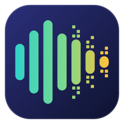

  

<h1 align="center">HitherDither</h1>

<a href="https://rnevillecodes.github.io/hither-dither/">rnevillecodes.github.io/hither-dither</a>

  

A lightweight desktop app for inspecting WAV files. It shows the waveform, format metadata and level statistics, and plays back the file or a selection of it. Several files can be open at once, each in its own tab. Built with Tauri v2 (Rust backend) and Svelte 5 + TypeScript (frontend).

## Download

Installers for released versions are on the [Releases page](https://github.com/rnevillecodes/hither-dither/releases). For a test build of a pull request or of `main`, open its run under [Actions › CI](https://github.com/rnevillecodes/hither-dither/actions/workflows/ci.yml) and download the artifact for your OS (kept for 14 days).

| OS | File | Notes |
| --- | --- | --- |
| Windows 10/11 (x64) | `HitherDither_<version>_x64-setup.exe` or `HitherDither_<version>_x64_en-US.msi` | The `.exe` is the usual installer; the `.msi` suits managed installs |
| macOS 11+ (Apple Silicon and Intel) | `HitherDither_<version>_universal.dmg` | One build for both chip types |
| Linux (x64) | `HitherDither_<version>_amd64.AppImage`, `.deb` or `.rpm` | AppImage runs without installing (`chmod +x` it first); `.deb` for Debian/Ubuntu, `.rpm` for Fedora/openSUSE |

### Opening unsigned builds

The installers aren't code-signed yet, so the OS warns the first time you open them:

- **Windows:** if SmartScreen says "Windows protected your PC", click **More info**, then **Run anyway**.
- **macOS:** if macOS says the app can't be opened, right-click (or Control-click) **HitherDither** in Applications and choose **Open**, then **Open** again. On newer macOS versions, open **System Settings › Privacy & Security** and click **Open Anyway** next to the HitherDither message.

## VST3 effects

Each tab can run its audio through a chain of VST3 effect plugins: EQs, compressors, limiters, reverbs and so on. Add them from the **Effects** view of the sidebar (the plug icon on the right edge) or **Effects › Add Effect…**. The chain is heard live as the file plays, and is written into the audio only when you export. The waveform and statistics always show the audio before effects; the level meter beside the waveform shows peak and RMS per channel after them, in step with what you hear (before the volume slider). Instruments, VST2, AU, CLAP and LV2 plugins aren't supported.

To keep a long chain tidy, put effects in groups. Select effects in the Effects view (click, Ctrl/Cmd+click, Shift+click) and press **Group** or **Ctrl/Cmd+G** (also **Effects › Group Effects**). A group has a header you can collapse, rename (double-click its name, press F2, or highlight it and press Ctrl/Cmd+R), drag to move with its effects, bypass, or remove along with its effects. Grouping doesn't change how the audio sounds: effects still run one after another in the order shown. A group's bypass switch bypasses all of its effects but leaves their own switches as they were, so turning it off brings back exactly what was on. **Ungroup** (Ctrl/Cmd+Shift+G, or the button on the group's header) puts the effects back in place. Groups are saved in session files; a session with groups can't be opened by versions of HitherDither from before groups.

HitherDither looks for plugins in the standard VST3 folders, including their subfolders:

| OS | Folders |
| --- | --- |
| Windows | `%COMMONPROGRAMFILES%\VST3` (usually `C:\Program Files\Common Files\VST3`) and `%LOCALAPPDATA%\Programs\Common\VST3` |
| macOS | `/Library/Audio/Plug-Ins/VST3` and `~/Library/Audio/Plug-Ins/VST3` |
| Linux | `~/.vst3`, `/usr/lib/vst3` and `/usr/local/lib/vst3` |

You can add other folders, rescan, and enable or disable plugins in **Effects › Manage Plugins…**. Plugins are scanned in the background, each in a separate process, so one that crashes or hangs while being scanned is marked as failed and doesn't stop the app. If the app closes unexpectedly while a plugin is loading or opening its editor, that plugin is disabled the next time the app starts, and you can enable it again in Manage Plugins.

Things to know:

- **Plugin editors on Linux** need an X11 display: an X11 session, or a Wayland session with XWayland. Without one, effects show generic sliders instead of their own editor. Under XWayland, an editor window may not stay above the main window.
- **On macOS**, a plugin must include a version for your Mac's processor. An Intel-only plugin is listed as incompatible on Apple Silicon.
- **Exporting renders the effects offline.** Some plugins switch to a higher-quality mode for offline rendering, or have random modulation, so the exported file can differ slightly from what you heard.
- Plugins run inside the app while they process audio or show their editor, so a plugin that crashes then takes the app with it, and unsaved changes are lost.

VST is a registered trademark of Steinberg Media Technologies GmbH.

## Saving and exporting

HitherDither never changes the WAV you open. Your work is saved as a session, and the audio is written only when you export it.

- **File › Save** (Ctrl/Cmd+S) saves the tab as a session file (`take.hdsession.json`), asking where the first time. **Save As…** (Ctrl/Cmd+Shift+S) saves it to a new session file. A session holds the edits, the effect chain in order with each effect's bypass switch, Bypass All, and every plugin's complete settings. It doesn't contain the audio: it points to the WAV.
- **File › Export…** (Ctrl/Cmd+E) renders the edits and effects to a new WAV (`take-export.wav` by default). The tab carries on as it was, with its edits, effects and undo history, so you can keep working and export again. Export won't write over the WAV you're editing or one open in another tab.
- **Unsaved changes** are anything since the session was last saved: edits, effect changes, bypass switches and plugin settings. Closing a tab or quitting asks whether to save the session.

Open a session with **File › Open…** or by dropping it on the window. Its WAV opens in a new tab with the edits and effects as they were. Effect editors start closed, and there is nothing to undo until the next change. When the app starts, tabs that had a session file are reopened from their session.

- **File › Replace Audio…** swaps a tab's WAV for another one, such as a different take or a new render of the mix, and keeps its effects with their settings and its session file. The edits and undo history are dropped (it asks first when there are any), because they belong to the old recording. Effects that can't process the new audio's channels are left out, with a notice.
- **If a session's WAV is missing or has changed**, opening the session offers **Choose Another WAV…**. A WAV with the recorded format and length (one that was moved or renamed) gets the session's edits as well as its effects; any other WAV gets only the effects. Save the session afterwards so it points to the new WAV.

Things to know:

- **Keep the session with its WAV.** A session finds its WAV at the path it was saved with, or at the same place relative to the session, so moving or copying a folder holding both works. Renaming or moving only the WAV doesn't.
- **A session only applies to the same recording.** If the WAV's format or length has changed, the session doesn't open. If only its date or size has changed, it opens with a warning.
- **Some plugins report a change as soon as their editor opens**, which marks the tab as unsaved even though nothing was changed by hand.
- **Missing effects are left out.** An effect that is no longer installed, is disabled, or fails to load is left out of the chain, with a notice. One that won't take its saved settings keeps its defaults.
- **Plugins that depend on more than their settings** (random modulation, sample files that have moved) may not sound identical when a session is reopened.
- The file is JSON, so it can be read in a text editor. Plugin settings are stored as the plugin's own data, in base64.

## Development

### Prerequisites

- **Rust** (stable, 1.85+ for edition 2024) via [rustup](https://rustup.rs)
- **Node.js** 20+ and npm
- Platform webview and audio libraries:
  - **Linux:** WebKitGTK 4.1 and ALSA headers, e.g. on Debian/Ubuntu:
    `sudo apt install libwebkit2gtk-4.1-dev libgtk-3-dev libsoup-3.0-dev libayatana-appindicator3-dev librsvg2-dev libasound2-dev build-essential pkg-config`
  - **Windows:** WebView2 runtime (preinstalled on Windows 10/11) and the MSVC build tools
  - **macOS:** Xcode Command Line Tools

See the [Tauri prerequisites guide](https://tauri.app/start/prerequisites/) for details.

### Commands

| Command | Purpose |
| --- | --- |
| `npm install` | Install frontend dependencies |
| `npm run tauri dev` | Run the app with hot reload |
| `npm run tauri build` | Build a release installer for the host platform |
| `npm run check` | Type-check the Svelte/TypeScript frontend |
| `npm test` | Run frontend unit tests (vitest) |
| `npm run lint:rust` | `cargo fmt --check` and `cargo clippy -D warnings` |
| `npm run test:rust` | Run Rust unit and integration tests |

### Layout

- `src-tauri/`: Rust crate (WAV parsing, peak pyramid, statistics, playback, VST3 hosting in `plugins/` and effect chains in `fx/`, Tauri commands)
- `src-tauri/test-plugins/`: small VST3 plugins built for the Rust tests
- `src/`: Svelte frontend (`lib/` holds pure logic and the canvas renderer, `components/` holds UI panels)
- `docs/`: IPC reference, performance and acceptance notes
- `site/`: the project website, published to GitHub Pages by `.github/workflows/pages.yml` when it changes on `main` (the icons are copied in from `src-tauri/icons/` at deploy time)
- `scripts/gen-icons.mjs`: generates the icon source (`src-tauri/icons/app-icon.svg`) and the empty-screen imprint (`src/assets/logo-shadow.svg`). After changing it, run `node scripts/gen-icons.mjs` and then `npx tauri icon src-tauri/icons/app-icon.svg`, and delete the generated `android/`, `ios/` and `64x64.png`, which the app doesn't use.
